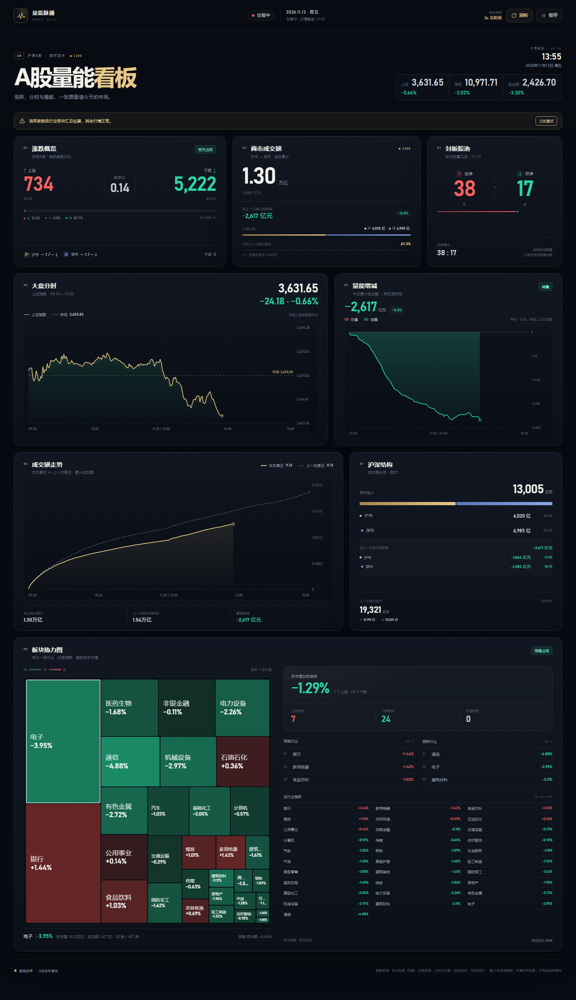

# A股量能看板 · 量能脉搏

沪深 A 股实时观察面板。把涨跌家数、上证分时、两市成交额、量能增减和封板股池放进同一张页面。



## 快速启动

**方式一：双击**

双击 `启动看板.bat`，浏览器会自动打开看板。

**方式二：命令行**

```bash
python server.py --open
```

或者：

```bash
python server.py
```

然后访问 `http://127.0.0.1:8765`。默认只监听本机，不会暴露到局域网。

> 需要 Python 3.9+。没有第三方依赖，也不需要 Node.js 或安装包管理器。

## 开机自动启动

原理很简单：把启动脚本的快捷方式放进 Windows 的「启动」文件夹
`%APPDATA%\Microsoft\Windows\Start Menu\Programs\Startup`，
每次登录后系统会自动运行它。

本目录提供两种自启方式，任选其一：

| 方式 | 操作 | 效果 |
| --- | --- | --- |
| **静默版（推荐，当前已启用）** | 双击 `安装开机自启.bat` | 后台运行，无任何窗口 |
| 窗口版 | 双击 `安装开机自启-窗口版.bat` | 运行 `启动看板.bat`，任务栏有最小化控制台窗口 |

取消自启：双击 `取消开机自启.bat`（两种方式都会移除）。

其他常用操作：

| 想做什么 | 操作 |
| --- | --- |
| 立即后台启动（不弹窗） | 双击 `启动看板-静默.vbs` |
| 停止正在运行的服务 | 双击 `停止看板.bat` |
| 检查是否在运行 | 任务管理器里找 `pythonw.exe`，或访问 `http://127.0.0.1:8765` |

手动方式（不使用脚本）：按 `Win + R` 输入 `shell:startup` 回车，
把 `启动看板.bat`（或 `启动看板-静默.vbs`）的快捷方式拖进去即可。

> 静默版不自动打开浏览器，需要时自己访问 `http://127.0.0.1:8765`。
> 首次启动若弹出 Windows 防火墙提示，请允许 `pythonw.exe` 在专用/域网络上的入站访问，手机才能连上。
> 「启动」文件夹在用户登录后触发；电脑还没登录桌面时服务不会运行。

## 手机访问

1. 双击 `启动看板-手机访问.bat`。
2. 确保手机和电脑连接**同一个 Wi-Fi / 局域网**。
3. 启动窗口会显示类似 `手机访问: http://10.188.64.185:8765` 的地址，在手机浏览器中打开即可。

也可以手动运行：

```bash
python server.py --lan --open
```

如果手机打不开：

- 检查手机和电脑是否在同一网段；公司 Wi-Fi 可能开启了设备隔离。
- 首次启动时如果出现 Windows 防火墙提示，请允许 Python 在**专用/域网络**上的入站访问。
- 也可手动在「Windows Defender 防火墙 → 允许应用通过防火墙」中允许 `python.exe`（TCP 8765）。
- 仅建议在可信的家庭/公司局域网使用 `--lan` 模式，不要把 8765 端口直接暴露到公网。

## 功能

- **涨跌概览**：沪深 A 股上涨 / 下跌 / 平盘家数、涨跌比、沪深两市分别统计。
- **板块热力图**：31 个申万一级行业整合在一个正方形 Treemap 中；面积按总市值，红色 / 绿色表示涨跌，颜色深浅表示幅度，每块显示涨跌幅。支持悬停、点击、键盘查看详情，并附全行业涨跌排行。
- **封板股池**：涨停、跌停家数，采用东方财富封板股池口径，并在页面上注明它不是全市场涨跌停总数。
- **大盘分时**：上证指数当日分时曲线、昨收参考线、涨跌幅；在图表上悬停或拖动可查看任意时点。
- **量能增减**：当前累计成交额与上一交易日同时段的差额曲线，单位亿元；零线上方放量，下方缩量。
- **两市成交额**：沪市 + 深市实时累计成交额，较上一交易日同时段的增减金额和百分比。
- **成交额走势**：本交易日与上一交易日累计成交额曲线对比，可拖动查看每个时点。
- **沪深结构**：沪市 / 深市成交额占比、各自较昨日的增量，以及上一交易日全天成交额与沪深拆分。
- **自动刷新**：页面打开且未暂停时每 5 秒刷新；支持手动刷新和暂停。页面隐藏时暂停网络请求，恢复可见后继续。
- **状态提示**：交易中、午间休市、已收盘、未开盘、周末 / 休市；休市时标明最近交易日。行情源异常时保留最近一次成功数据并提示重试。

## 数据说明

数据来自东方财富公开行情接口，由本地 `server.py` 聚合后提供给浏览器：

- 指数快照、涨跌家数与 31 个申万一级行业：`push2.eastmoney.com`（一次批量请求）
- 沪深两市分时成交额：`push2his.eastmoney.com` / `push2.eastmoney.com`（互为备用），取两个交易日，用于同时段对比
- 涨停 / 跌停家数：东方财富封板股池

> 东方财富对同一 IP 有频率限制。服务端做了防护：分时 6 秒、板块 20 秒、整体 4.2 秒缓存；失败时自动退避（最长 30 秒）；urllib 被拦时改用系统 `curl.exe` 兜底；分时不可用时降级显示快照。

成交量单位统一为人民币。页面上的「今日累计」由沪市与深市指数成交额相加得到；曲线中的累计成交额由分时成交额逐分钟累加，并以指数快照实时值校正末端。

## 文件结构

```text
index.html          页面结构
styles.css          视觉样式与响应式布局
app.js              数据绑定、图表绘制、悬停 / 拖动交互、自动刷新
server.py           本地静态服务 + 东方财富数据聚合 / 缓存 / 降级
favicon.svg         站点图标
preview.png         页面预览图
启动看板.bat         Windows 双击启动（仅本机，有窗口）
启动看板-手机访问.bat 手机 / 局域网访问（有窗口）
启动看板-静默.vbs   无窗口后台启动（开机自启调用的就是它）
安装开机自启.bat     写入开机启动项（静默，无窗口）
安装开机自启-窗口版.bat 写入开机启动项（运行 bat，有窗口）
取消开机自启.bat     移除开机启动项
停止看板.bat         停止正在运行的看板服务
_autostart.vbs      开机自启的安装 / 移除逻辑
```

## 说明

- 默认只在本机运行；使用手机访问模式时会监听局域网地址，请只在可信网络中使用。
- 行情数据由公开接口提供，可能出现延迟、限流或字段变更。
- 本页面用于行情观察和界面演示，不构成任何投资建议。
- 快捷键：`R` 立即刷新。
